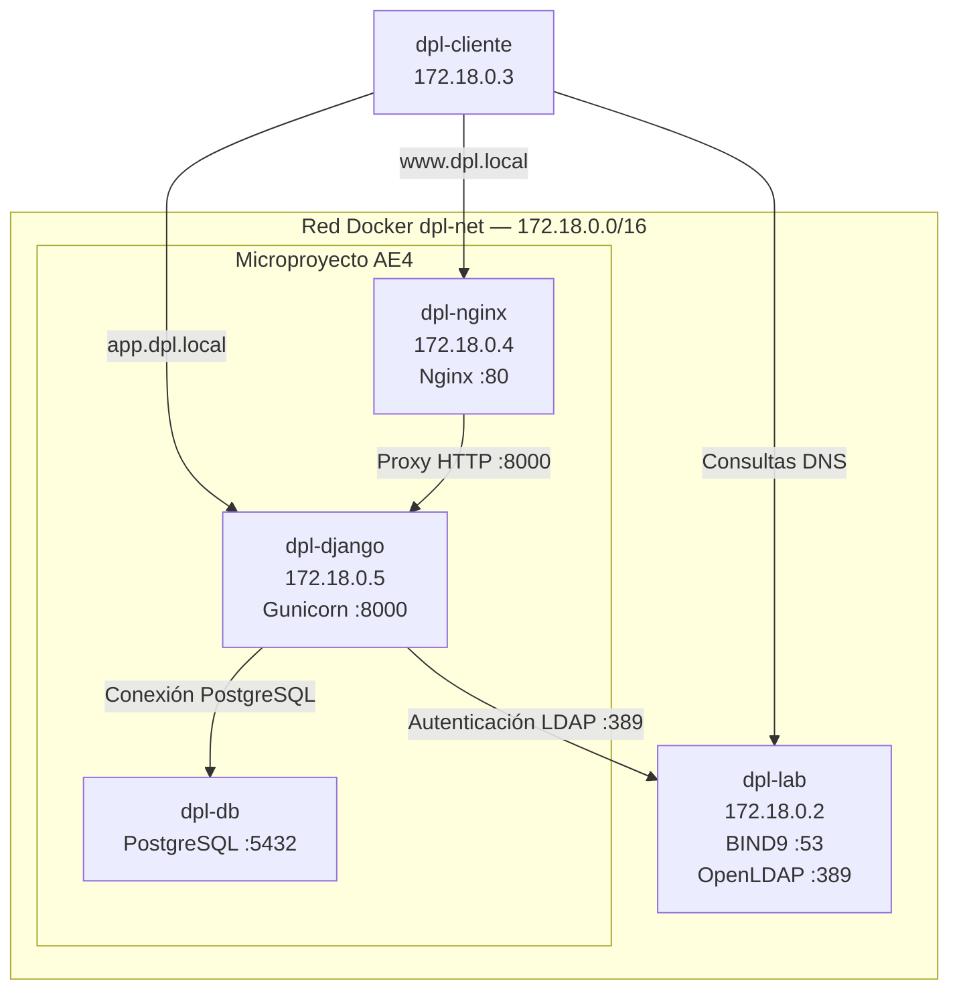

# DNS y servicio de directorio para el despliegue

Se pretende incorporar un servicio DNS propio mediante BIND9 y un servicio de directorio LDAP mediante OpenLDAP al microproyecto desarrollado en la AE4.

## Entorno de trabajo

El entorno está compuesto por los siguientes contenedores Docker:

| **Contenedor** | **Dirección IP** | **Función** |
| --- | --- | --- |
| dpl-lab | 172.18.0.2 | Servidor de laboratorio, DNS y LDAP |
| dpl-cliente |	172.18.0.3 | Cliente para realizar pruebas |
| dpl-nginx | 172.18.0.4 | Servidor web NGINX |
| dpl-django | 172.18.0.5 | Aplicación Django con Gunicorn |
| dpl-db | Dinámica | Base de datos PostgreSQL |

Todos los contenedores participan en la red Docker dpl-net.

### Puertos principales

| **Servicio** | **Puerto** |
| --- | --- |
| DNS (BIND9) |	53 UDP/TCP |
| LDAP (OpenLDAP) | 389 TCP |
| Nginx | 80 TCP |
| Django/Gunicorn | 8000 TCP |
| Nginx publicado en el anfitrión | 8001 TCP |

El puerto 8001 del anfitrión se redirige al puerto 80 del contenedor Nginx.

## Arquitectura



## Configuración del servicio DNS

### Instalación

BIND9 se ha instalado directamente en el contenedor dpl-lab:

```bash
apt update
apt install -y bind9 bind9-utils
```

Se ha comprobado la versión instalada:

```bash
named -v
```

Resultado:

```text
BIND 9.18.39-0ubuntu0.24.04.8-Ubuntu
```

## Configuración de la zona

Se ha configurado una zona **DNS** autoritativa denominada dpl.local.

Archivo de configuración: /etc/bind/named.conf.local:

```text
//
// Do any local configuration here
//
zone "dpl.local" {
	type master;
	file "/etc/bind/db.dpl.local";
};

// Consider adding the 1918 zones here, if they are not used in your
// organization
//include "/etc/bind/zones.rfc1918";
```

La zona se declara como tipo master y utiliza el archivo /etc/bind/db.dpl.local.

Archivo de configuración /etc/bind/db.dpl.local:

```text
$TTL 3600
$ORIGIN dpl.local.
@       IN  SOA ns1.dpl.local. admin.dpl.local. (
        2026103101 ; serial
        3600       ; refresh
        900        ; retry
        604800     ; expire
        86400 )    ; minimum TTL
@       IN  NS  ns1.dpl.local.
ns1     IN  A   172.18.0.2
www     IN  A   172.18.0.4
app     IN  A   172.18.0.5
```

Este archivo define la zona DNS autoritativa dpl.local, estableciendo los registros SOA y NS y asociando los nombres ns1, www y app con sus respectivas direcciones IP dentro de la red Docker dpl-net.

## Arranque del servicio

Se comprueba que la configuración es válida:

```bash
docker exec dpl-lab named-checkconf
docker exec dpl-lab named-checkzone dpl.local /etc/bind/db.dpl.local
```

Ambos deben terminar sin errores (el segundo muestra OK)

Tras la comprobación al no utilizar systemd en los contenedores, **BIND9** se ejecuta directamente en primer plano:

```bash
docker exec -it dpl-lab named -g -c /etc/bind/named.conf
```

## Comprobación del proceso y del puerto

Se ha comprobado que el proceso named permanece activo desde otra terminal:

```bash
docker exec dpl-lab pgrep -a named
```

Resultado:

```text
368 named -g -c /etc/bind/named.conf
```

También se ha comprobado que escucha en el puerto 53 de la red dpl-net:

```bash
docker exec dpl-lab ss -lunp | grep :53
```

Salida:

```text
UNCONN 0      0         172.18.0.2:53         0.0.0.0:*    users:(("named",pid=368,fd=75))
UNCONN 0      0         172.18.0.2:53         0.0.0.0:*    users:(("named",pid=368,fd=73))
UNCONN 0      0         172.18.0.2:53         0.0.0.0:*    users:(("named",pid=368,fd=76))
UNCONN 0      0         172.18.0.2:53         0.0.0.0:*    users:(("named",pid=368,fd=74))
UNCONN 0      0         172.18.0.2:53         0.0.0.0:*    users:(("named",pid=368,fd=72))
UNCONN 0      0         172.17.0.2:53         0.0.0.0:*    users:(("named",pid=368,fd=65))
UNCONN 0      0         172.17.0.2:53         0.0.0.0:*    users:(("named",pid=368,fd=66))
UNCONN 0      0         172.17.0.2:53         0.0.0.0:*    users:(("named",pid=368,fd=64))
UNCONN 0      0         172.17.0.2:53         0.0.0.0:*    users:(("named",pid=368,fd=63))
UNCONN 0      0         172.17.0.2:53         0.0.0.0:*    users:(("named",pid=368,fd=62))
UNCONN 0      0          127.0.0.1:53         0.0.0.0:*    users:(("named",pid=368,fd=50))
UNCONN 0      0          127.0.0.1:53         0.0.0.0:*    users:(("named",pid=368,fd=51))
UNCONN 0      0          127.0.0.1:53         0.0.0.0:*    users:(("named",pid=368,fd=47))
UNCONN 0      0          127.0.0.1:53         0.0.0.0:*    users:(("named",pid=368,fd=49))
UNCONN 0      0          127.0.0.1:53         0.0.0.0:*    users:(("named",pid=368,fd=48))
UNCONN 0      0              [::1]:53            [::]:*    users:(("named",pid=368,fd=83))
UNCONN 0      0              [::1]:53            [::]:*    users:(("named",pid=368,fd=82))
UNCONN 0      0              [::1]:53            [::]:*    users:(("named",pid=368,fd=84))
UNCONN 0      0              [::1]:53            [::]:*    users:(("named",pid=368,fd=86))
UNCONN 0      0              [::1]:53            [::]:*    users:(("named",pid=368,fd=85))
```
