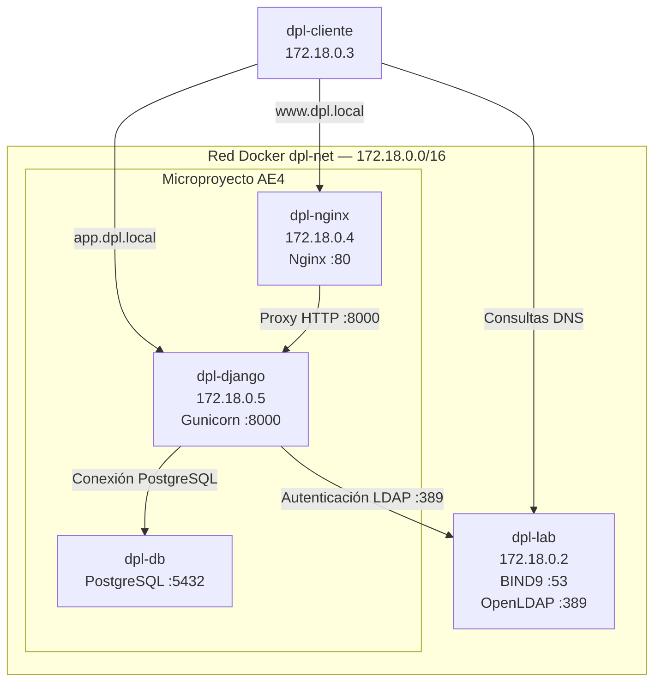

# DNS y servicio de directorio para el despliegue

Se pretende incorporar un servicio DNS propio mediante BIND9 y un servicio de directorio LDAP mediante OpenLDAP al microproyecto desarrollado en la AE4.

## Entorno de trabajo

El entorno está compuesto por los siguientes contenedores Docker:

| **Contenedor** | **Dirección IP** | **Función** |
| --- | --- | --- |
| dpl-lab | 172.18.0.2 | Servidor de laboratorio, DNS y LDAP |
| dpl-cliente |	172.18.0.3 | Cliente para realizar pruebas |
| dpl-nginx | 172.18.0.4 | Servidor web NGINX |
| dpl-django | 172.18.0.5 | Aplicación Django con Gunicorn |
| dpl-db | Dinámica | Base de datos PostgreSQL |

Todos los contenedores participan en la red Docker dpl-net.

### Puertos principales

| **Servicio** | **Puerto** |
| --- | --- |
| DNS (BIND9) |	53 UDP/TCP |
| LDAP (OpenLDAP) | 389 TCP |
| Nginx | 80 TCP |
| Django/Gunicorn | 8000 TCP |
| Nginx publicado en el anfitrión | 8001 TCP |

El puerto 8001 del anfitrión se redirige al puerto 80 del contenedor Nginx.

## Arquitectura



## Configuración del servicio DNS

### Instalación

BIND9 se ha instalado directamente en el contenedor dpl-lab:

```bash
apt update
apt install -y bind9 bind9-utils
```

Se ha comprobado la versión instalada:

```bash
named -v
```

Resultado:

```text
BIND 9.18.39-0ubuntu0.24.04.8-Ubuntu
```

## Configuración de la zona

Se ha configurado una zona **DNS** autoritativa denominada dpl.local.

Archivo de configuración: /etc/bind/named.conf.local:

```text
//
// Do any local configuration here
//
zone "dpl.local" {
	type master;
	file "/etc/bind/db.dpl.local";
};

// Consider adding the 1918 zones here, if they are not used in your
// organization
//include "/etc/bind/zones.rfc1918";
```

La zona se declara como tipo master y utiliza el archivo /etc/bind/db.dpl.local.

Archivo de configuración /etc/bind/db.dpl.local:

```text
$TTL 3600
$ORIGIN dpl.local.
@       IN  SOA ns1.dpl.local. admin.dpl.local. (
        2026103101 ; serial
        3600       ; refresh
        900        ; retry
        604800     ; expire
        86400 )    ; minimum TTL
@       IN  NS  ns1.dpl.local.
ns1     IN  A   172.18.0.2
www     IN  A   172.18.0.4
app     IN  A   172.18.0.5
```

Este archivo define la zona DNS autoritativa dpl.local, estableciendo los registros SOA y NS y asociando los nombres ns1, www y app con sus respectivas direcciones IP dentro de la red Docker dpl-net.

## Arranque del servicio

Se comprueba que la configuración es válida:

```bash
docker exec dpl-lab named-checkconf
docker exec dpl-lab named-checkzone dpl.local /etc/bind/db.dpl.local
```

Ambos deben terminar sin errores (el segundo muestra OK)

Tras la comprobación al no utilizar systemd en los contenedores, **BIND9** se ejecuta directamente en primer plano:

```bash
docker exec -it dpl-lab named -g -c /etc/bind/named.conf
```

## Comprobación del proceso y del puerto

Se ha comprobado que el proceso named permanece activo desde otra terminal:

```bash
docker exec dpl-lab pgrep -a named
```

Resultado:

```text
368 named -g -c /etc/bind/named.conf
```

También se ha comprobado que escucha en el puerto 53 de la red dpl-net:

```bash
docker exec dpl-lab ss -lunp | grep :53
```

Salida:

```text
UNCONN 0      0         172.18.0.2:53         0.0.0.0:*    users:(("named",pid=368,fd=75))
UNCONN 0      0         172.18.0.2:53         0.0.0.0:*    users:(("named",pid=368,fd=73))
UNCONN 0      0         172.18.0.2:53         0.0.0.0:*    users:(("named",pid=368,fd=76))
UNCONN 0      0         172.18.0.2:53         0.0.0.0:*    users:(("named",pid=368,fd=74))
UNCONN 0      0         172.18.0.2:53         0.0.0.0:*    users:(("named",pid=368,fd=72))
UNCONN 0      0         172.17.0.2:53         0.0.0.0:*    users:(("named",pid=368,fd=65))
UNCONN 0      0         172.17.0.2:53         0.0.0.0:*    users:(("named",pid=368,fd=66))
UNCONN 0      0         172.17.0.2:53         0.0.0.0:*    users:(("named",pid=368,fd=64))
UNCONN 0      0         172.17.0.2:53         0.0.0.0:*    users:(("named",pid=368,fd=63))
UNCONN 0      0         172.17.0.2:53         0.0.0.0:*    users:(("named",pid=368,fd=62))
UNCONN 0      0          127.0.0.1:53         0.0.0.0:*    users:(("named",pid=368,fd=50))
UNCONN 0      0          127.0.0.1:53         0.0.0.0:*    users:(("named",pid=368,fd=51))
UNCONN 0      0          127.0.0.1:53         0.0.0.0:*    users:(("named",pid=368,fd=47))
UNCONN 0      0          127.0.0.1:53         0.0.0.0:*    users:(("named",pid=368,fd=49))
UNCONN 0      0          127.0.0.1:53         0.0.0.0:*    users:(("named",pid=368,fd=48))
UNCONN 0      0              [::1]:53            [::]:*    users:(("named",pid=368,fd=83))
UNCONN 0      0              [::1]:53            [::]:*    users:(("named",pid=368,fd=82))
UNCONN 0      0              [::1]:53            [::]:*    users:(("named",pid=368,fd=84))
UNCONN 0      0              [::1]:53            [::]:*    users:(("named",pid=368,fd=86))
UNCONN 0      0              [::1]:53            [::]:*    users:(("named",pid=368,fd=85))
```

## Configuración DNS de dpl-cliente

Para que el contenedor dpl-cliente utilice el servidor DNS BIND9 instalado en dpl-lab, se ha configurado su resolución DNS para consultar la dirección 172.18.0.2.

Se ha establecido la siguiente configuración en /etc/resolv.conf:

```text
nameserver 172.18.0.2
search home
options ndots:0
```

Para realizar las consultas desde el cliente se ha instalado dnsutils y ping:

```bash
docker exec -it dpl-cliente apt update
docker exec -it dpl-cliente apt install -y dnsutils iputils-ping
```

### Comprobación de la resolución DNS

Desde el cliente se han realizado consultas utilizando dig:

```bash
docker exec dpl-cliente dig www.dpl.local
docker exec dpl-cliente dig app.dpl.local
```

Los resultados obtenidos han sido:


```text
; <<>> DiG 9.18.39-0ubuntu0.24.04.8-Ubuntu <<>> www.dpl.local
;; global options: +cmd
;; Got answer:
;; WARNING: .local is reserved for Multicast DNS
;; You are currently testing what happens when an mDNS query is leaked to DNS
;; ->>HEADER<<- opcode: QUERY, status: NOERROR, id: 31903
;; flags: qr aa rd ra; QUERY: 1, ANSWER: 1, AUTHORITY: 0, ADDITIONAL: 1

;; OPT PSEUDOSECTION:
; EDNS: version: 0, flags:; udp: 1232
; COOKIE: 37a104d724c5f4ad010000006ae629395541cc1fd40c1e64 (good)
;; QUESTION SECTION:
;www.dpl.local.			IN	A

;; ANSWER SECTION:
www.dpl.local.		3600	IN	A	172.18.0.4

;; Query time: 0 msec
;; SERVER: 172.18.0.2#53(172.18.0.2) (UDP)
;; WHEN: Sat Oct 31 17:45:29 UTC 2026
;; MSG SIZE  rcvd: 86


; <<>> DiG 9.18.39-0ubuntu0.24.04.8-Ubuntu <<>> app.dpl.local
;; global options: +cmd
;; Got answer:
;; WARNING: .local is reserved for Multicast DNS
;; You are currently testing what happens when an mDNS query is leaked to DNS
;; ->>HEADER<<- opcode: QUERY, status: NOERROR, id: 61440
;; flags: qr aa rd ra; QUERY: 1, ANSWER: 1, AUTHORITY: 0, ADDITIONAL: 1

;; OPT PSEUDOSECTION:
; EDNS: version: 0, flags:; udp: 1232
; COOKIE: 53ada25ab0d87495010000006ae6293e8af9dce3768ab78f (good)
;; QUESTION SECTION:
;app.dpl.local.			IN	A

;; ANSWER SECTION:
app.dpl.local.		3600	IN	A	172.18.0.5

;; Query time: 0 msec
;; SERVER: 172.18.0.2#53(172.18.0.2) (UDP)
;; WHEN: Sat Oct 31 17:45:34 UTC 2026
;; MSG SIZE  rcvd: 86
```

Ambas consultas han devuelto el estado NOERROR y la respuesta autoritativa (aa), confirmando que BIND9 resuelve correctamente los nombres definidos en la zona dpl.local.

Consulta mediante nslookup:

```bash
docker exec dpl-cliente nslookup www.dpl.local
```

Salida: 

```text
Server:		172.18.0.2
Address:	172.18.0.2#53

Name:	www.dpl.local
Address: 172.18.0.4
```

Consulta del registro A mediante host:

```bash
docker exec dpl-cliente host -t a www.dpl.local
```

Salida:

```text
www.dpl.local has address 172.18.0.4
```

Comprobación de conectividad mediante ping:

```bash
docker exec dpl-cliente ping -c 3 www.dpl.local
```

Resultado:

```text
PING www.dpl.local (172.18.0.4) 56(84) bytes of data.
64 bytes from 172.18.0.4: icmp_seq=1 ttl=64 time=10.5 ms
64 bytes from 172.18.0.4: icmp_seq=2 ttl=64 time=0.133 ms
64 bytes from 172.18.0.4: icmp_seq=3 ttl=64 time=0.041 ms

--- www.dpl.local ping statistics ---
3 packets transmitted, 3 received, 0% packet loss, time 2062ms
rtt min/avg/max/mdev = 0.041/3.552/10.484/4.901 ms
```

Las pruebas confirman que el cliente utiliza correctamente el servidor DNS de laboratorio y puede resolver y alcanzar el servidor web mediante su nombre de dominio.

### Acceso HTTP

Una vez verificada la resolución DNS desde el contenedor dpl-cliente, se comprueba el acceso a los servicios web mediante sus nombres de dominio.

Ejecutamos curl hacia Nginx:

```bash
docker exec dpl-cliente curl -I http://www.dpl.local
```

Resultado:

```text
HTTP/1.1 200 OK
Server: nginx/1.27.5
Date: Sat, 31 Oct 2026 18:33:46 GMT
Content-Type: text/html; charset=utf-8
Connection: keep-alive
```

Acceso directo a Django/Gunicorn:

```bash
docker exec dpl-cliente curl -i http://app.dpl.local:8000/api/mensaje
```

Resultado:

```text
HTTP/1.1 200 OK
Server: gunicorn
Date: Sat, 31 Oct 2026 18:34:54 GMT
Connection: close
Transfer-Encoding: chunked
Content-Type: application/json

{"mensaje": "Hola desde el servidor de aplicaciones DPL (UT4)", "hostname": "1b37018193ea", "fecha": "2026-10-31T19:34100   123    0   123    0     0  28062      0 --:--:-- --:--:-- --:--:-- 30750
```

Por último, comprobamos el acceso a Django pero a través del proxy inverso de NGINX:

```bash
docker exec dpl-cliente curl -i http://www.dpl.local/api/mensaje
```

Resultado:

```text
HTTP/1.1 200 OK
Server: nginx/1.27.5
Date: Sat, 31 Oct 2026 18:36:26 GMT
Content-Type: application/json
Transfer-Encoding: chunked
Connection: keep-alive
```

Se verifica la resolución DNS, la conectividad entre contenedores y el funcionamiento de NGINX y Django mediante sus nombres de dominio.

## Problemas y soluciones

### Proceso slapd iniciado incorrectamente

Al comprobar el proceso de OpenLDAP mediante:

```bash
docker exec dpl-lab pgrep -a slapd
```

Mostraba `835 slapd -V`

Primero se detuvo el proceso anterior:

```bash
docker exec dpl-lab pkill slapd
```

Después se inició OpenLDAP en primer plano, sin systemd:

```bash
docker exec -d dpl-lab slapd -d 0 -h "ldap:///"
```

La salida ahora tras pgrep sí fue la esperada:

```text
949 slapd -d 0 -h ldap:///
```
